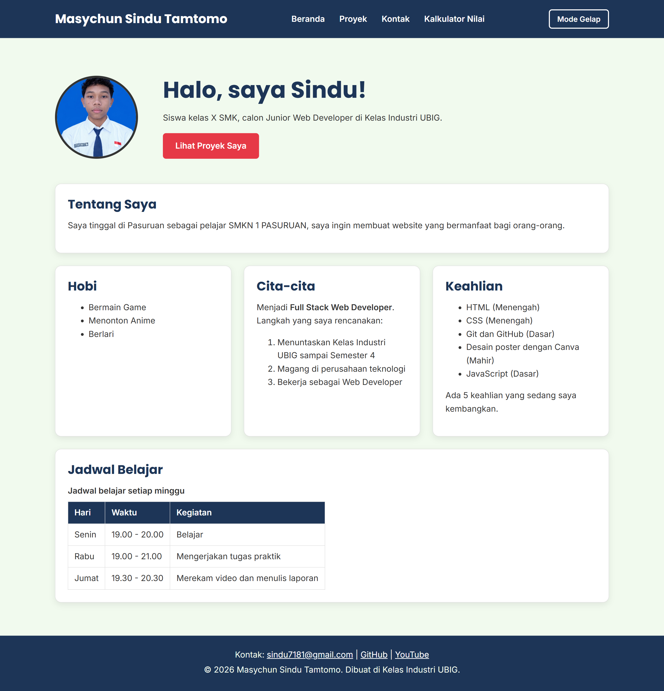
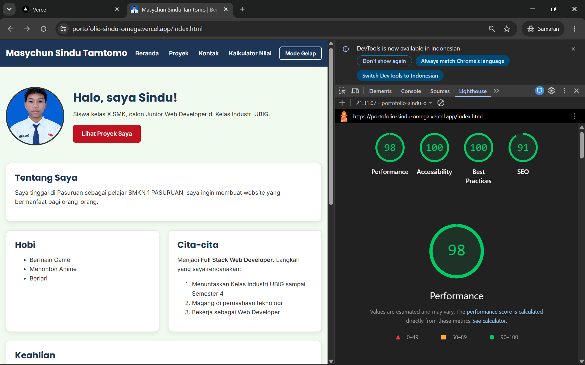

# Portofolio Masychun Sindu Tamtomo
Halaman Beranda berisi profil, hobi, cita-cita, jadwal belajar, dan daftar keahlian dari data/keahlian.json yang bisa ditambah
Halaman Proyek berisi enam kartu proyek dari data/proyek.json dengan filter kategori, serta repositori GitHub terbaru dari GitHub API
Halaman Kontak berisi form dengan penghitung karakter pesan
Mode gelap di semua halaman
Tampilan responsif dengan Flexbox dan media query
## Tampilan

## Fitur
Halaman Beranda berisi profil, hobi, cita-cita, jadwal belajar, dan daftar keahlian dari data/keahlian.json yang bisa ditambah
Halaman Proyek berisi enam kartu proyek dari data/proyek.json dengan filter kategori, serta repositori GitHub terbaru dari GitHub API
Halaman Kontak berisi form dengan penghitung karakter pesan
Mode gelap di semua halaman
Tampilan responsif dengan Flexbox dan media query
## Teknologi
HTML5 dan CSS3 (Flexbox, media query, dan variabel CSS)
JavaScript (DOM, event, fetch, dan async/await)
JSON dan GitHub REST API
Git, GitHub, dan Vercel
## Lighthouse (mobile)
Beranda: Performance 96, Accessibility 100, Best Practices 100, SEO 100
Proyek: Performance 95, Accessibility 100, Best Practices 100, SEO 100
Kontak: Performance 99, Accessibility 100, Best Practices 100, SEO 100
## Tautan
- Website: https://portofolio-sindu-git-main-masychunsindu01.vercel.app/
- Dibuat oleh: Masychun Sindu Tamtomo, SMKN 1 Pasuruan
